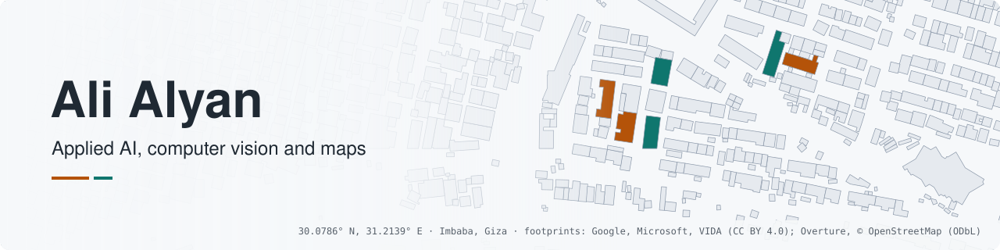
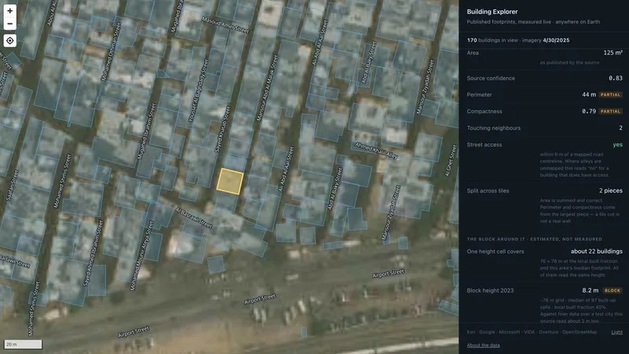
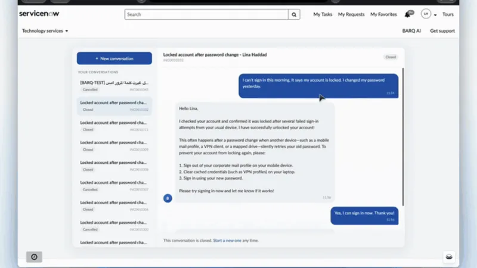
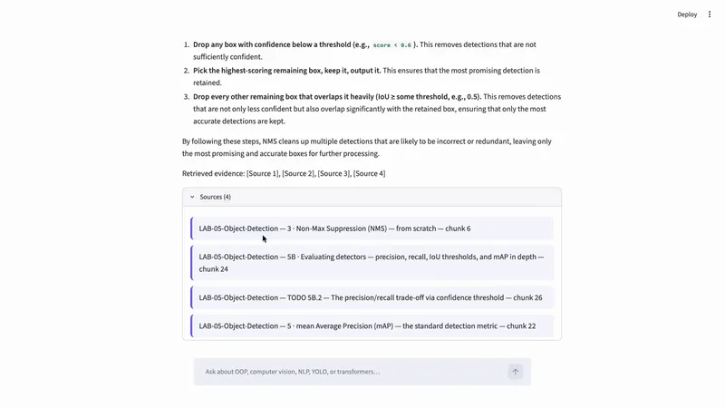
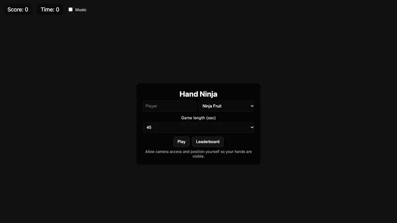
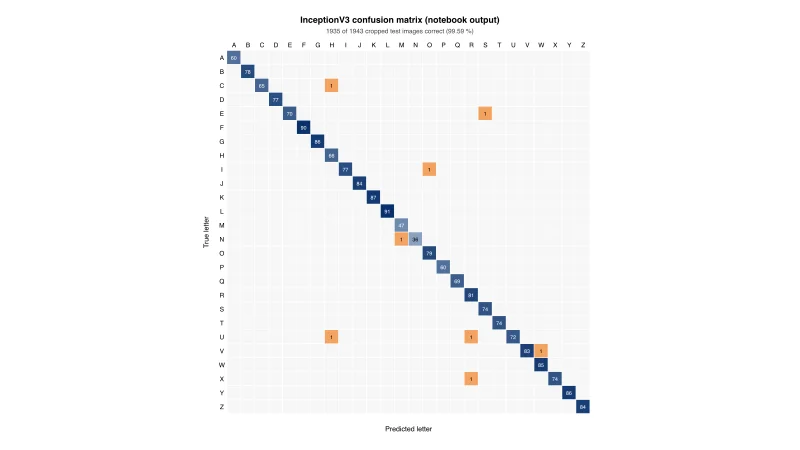
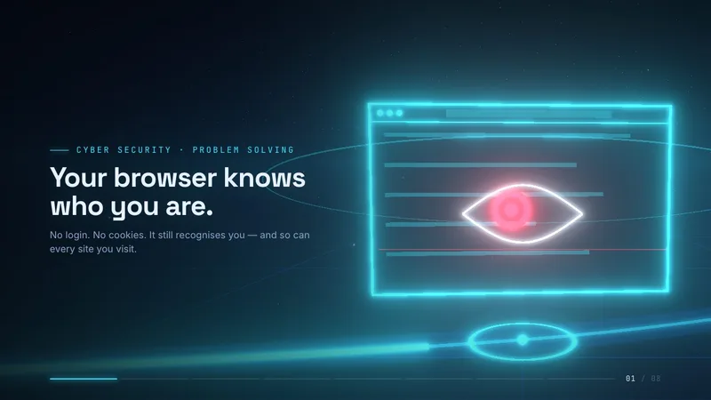

<picture>
  <source media="(prefers-color-scheme: dark)" srcset="assets/banner-dark.svg">
  
</picture>

I'm Ali, a Data Science student at Helwan National University in Cairo, Egypt. I build applied AI projects: computer vision in the browser and in Python, assistants that answer from documents and cite them, an agent that works ServiceNow tickets, and web maps for remote-sensing data. At NARSS (the National Authority for Remote Sensing and Space Sciences) I built [building-explorer](https://github.com/ali-ezz/building-explorer).

Each project below says what was tested and what was not.

## Selected work

<table>
<tr>
<td width="50%" valign="top">

 <b><a href="https://github.com/ali-ezz/building-explorer">building-explorer</a></b> · <a href="https://ali-ezz.github.io/building-explorer/">live map</a>
 A single-file web map of open building footprints and heights for anywhere on Earth, with measurements in the browser and export for QGIS. Built at NARSS.
 MapLibre · PMTiles · Overture Maps · GeoTIFF
</td>
<td width="50%" valign="top">

 <b><a href="https://github.com/ali-ezz/servicenow-incident-agent">servicenow-incident-agent</a></b>
 An agent that investigates ServiceNow incidents, chats with the caller, follows hard policy rules and hands the ticket to a person when it should not decide alone. My work for the BARQ x Sprints programme, built on the team's platform.
 FastAPI · Celery · LangGraph · Qdrant · Langfuse
</td>
</tr>
<tr>
<td width="50%" valign="top">

 <b><a href="https://github.com/ali-ezz/rag-assistant">rag-assistant</a></b>
 Answers questions about 12 AI course labs with a small local model and lists the sections it used. For 12 of 12 test questions the expected lab is among the four chunks it retrieves.
 FastAPI · ChromaDB · Ollama · Streamlit · Docker Compose
</td>
<td width="50%" valign="top">

 <b><a href="https://github.com/ali-ezz/hand-tracking-games">hand-tracking-games</a></b> · <a href="https://ali-ezz.github.io/hand-tracking-games/">play</a>
 Five browser games you control by moving your hand in front of the webcam, with multiplayer rooms through a small Node server.
 MediaPipe Hands · JavaScript · Canvas · Socket.IO
</td>
</tr>
<tr>
<td width="50%" valign="top">

 <b><a href="https://github.com/ali-ezz/asl-alphabet-recognition">asl-alphabet-recognition</a></b> · team
 Recognises ASL alphabet letters from images, video or the webcam: MediaPipe finds the hand, three Keras models vote on the letter.
 TensorFlow · Keras · MediaPipe · Streamlit
</td>
<td width="50%" valign="top">

 <b><a href="https://github.com/ali-ezz/Whos-Watching-Your-Browser">Whos-Watching-Your-Browser</a></b> · <a href="https://ali-ezz.github.io/Whos-Watching-Your-Browser/">open</a>
 An interactive 3D presentation on browser security, with a page that shows what your own browser gives away for fingerprinting.
 Three.js · GSAP · Vite
</td>
</tr>
</table>

Pictures are cut from each repository's own screenshots and figures (the ServiceNow one from its demo recording, test data only).

## More projects

**AI and machine learning**
- [mizan-arabic-legal-assistant](https://github.com/ali-ezz/mizan-arabic-legal-assistant): answers Egyptian legal questions in Arabic from retrieved law text (BM25, FAISS, Gradio). Team.
- [voice-vision-drone-assistant](https://github.com/ali-ezz/voice-vision-drone-assistant): a DJI Tello prototype driven by voice commands and YOLO camera detection, with a simulator mode.
- [CareerBuddy](https://github.com/ali-ezz/CareerBuddy): searches remote jobs and asks an LLM to estimate how exposed each one is to automation.
- [evolutionary-algorithms-visualizer](https://github.com/ali-ezz/evolutionary-algorithms-visualizer): watch a genetic algorithm and differential evolution improve side by side.
- [image-video-mosaic](https://github.com/ali-ezz/image-video-mosaic): rebuilds an image or video as a grid of tinted copies of itself.
- [house-price-segmentation-app](https://github.com/ali-ezz/house-price-segmentation-app): house price regression and customer clustering in a Streamlit app. Team.

**Web**
- [cgpa-calculator](https://github.com/ali-ezz/cgpa-calculator): Arabic semester and cumulative GPA calculator ([open](https://the-list-rho.vercel.app)).
- [student-management-platform](https://github.com/ali-ezz/student-management-platform): student records and a task manager (FastAPI, React, PostgreSQL). Team.
- [cloth-shop](https://github.com/ali-ezz/cloth-shop): static front end of a clothing shop. Team.

**Data and dashboards**
- [bank-loan-powerbi-dashboard](https://github.com/ali-ezz/bank-loan-powerbi-dashboard): Power BI dashboard on 38,576 bank loan records.
- [recession-car-sales-dashboard](https://github.com/ali-ezz/recession-car-sales-dashboard): car sales in recession and normal years, in a Plotly Dash app.
- [spotify-trends-dashboard](https://github.com/ali-ezz/spotify-trends-dashboard): Spotify track data cleaned and charted in Dash. Team.
- [movie-data-analysis](https://github.com/ali-ezz/movie-data-analysis): cleaning, hypothesis tests and PCA on movie metadata. Team.
- [python-eda-toolkit](https://github.com/ali-ezz/python-eda-toolkit): classes for loading, cleaning, testing and plotting tabular data.
- [airline-mapreduce-pipeline](https://github.com/ali-ezz/airline-mapreduce-pipeline): two Hadoop MapReduce jobs in Java; the data generators are missing, so it does not run as committed. Team.

**Systems and coursework**
- [javafx-course-manager](https://github.com/ali-ezz/javafx-course-manager): JavaFX desktop app for courses, enrolments and grades. Team.
- [secure-student-records](https://github.com/ali-ezz/secure-student-records): role-based access, inference control and audit logging in a Tkinter app. Team.
- [oracle-university-exam-system](https://github.com/ali-ezz/oracle-university-exam-system): Oracle SQL and PL/SQL for registration, results and auditing. Team.
- [c-role-based-file-manager](https://github.com/ali-ezz/c-role-based-file-manager): menu-driven file manager in C with separate roles.
- [flight-booking-cli](https://github.com/ali-ezz/flight-booking-cli) and [vaccine-booking-cli](https://github.com/ali-ezz/vaccine-booking-cli): booking programs for the command line.
- [python-algorithm-exercises](https://github.com/ali-ezz/python-algorithm-exercises) and [python-mini-scripts](https://github.com/ali-ezz/python-mini-scripts): practice code with tests.

## Tools I have used in these projects

| Area | Tools |
|---|---|
| Languages | Python, JavaScript, Java, SQL, C |
| Vision and ML | TensorFlow and Keras, MediaPipe, OpenCV, YOLO, scikit-learn |
| LLMs and retrieval | LangGraph, Langfuse, Qdrant, ChromaDB, FAISS, Ollama, sentence-transformers |
| Back end | FastAPI, Celery, Docker Compose, PostgreSQL |
| Maps | MapLibre, PMTiles, Overture Maps, GeoTIFF |
| Data and dashboards | pandas, Plotly Dash, Streamlit, Power BI |

## Contact

[LinkedIn](https://www.linkedin.com/in/ali-ezz-alyan/) · [Portfolio](https://ali-ezz-portfolio.vercel.app/) (with my certificates)

Banner: building outlines in Imbaba, Giza, read from building-explorer. Footprints from Google Open Buildings and Microsoft, combined by VIDA (CC BY 4.0), and Overture Maps, which includes data © OpenStreetMap contributors (ODbL).
