<picture>
  <source media="(max-width: 600px)" srcset="assets/header-phone.svg">
  
</picture>

```ansi
▸ click a command to run it ↓
```

<details>
<summary><code>ali@cairo:~$ cat about.txt</code></summary>
<br>

```ansi
   .-------.
  (_________)   Ali Alyan
  |         |   ─────────
  |~~~~~~~~~|   study Data Science
  |         |   city  Cairo
  |~~~~~~~~~|   1st   data eng
   \_______/    2nd   applied AI

I study Data Science at
Helwan National University
in Cairo.

My main focus is
data engineering, because good
AI systems need strong data
foundations.

My second focus is applied AI:
models and LLMs inside real
products, not isolated demos.
```

</details>

<details>
<summary><code>ali@cairo:~$ ls skills/</code></summary>
<br>

```ansi
skills/
├── languages/
│   ├── Python  Java  SQL
│   ├── JavaScript  TypeScript
│   └── C  C++
├── data-and-streaming/
│   ├── PostgreSQL  MySQL
│   ├── MongoDB
│   └── Apache Spark + Kafka
├── ai-and-ml/
│   ├── TensorFlow  PyTorch
│   ├── LangChain  MLflow
│   └── Hugging Face
├── backend/
│   └── Flask  Django  Node.js
├── cloud-and-devops/
│   ├── AWS  GCP  Azure
│   └── Docker  Kubernetes
├── web-and-product/
│   ├── HTML  CSS  React  Vite
│   └── Vercel Firebase Supabase
└── tools/
    ├── Git  GitHub  VS Code
    └── Linux  Bash

7 directories
```

</details>

<details>
<summary><code>ali@cairo:~$ ./how-i-think.sh</code></summary>
<br>

<p></p>

```ansi
I care about the full path from
raw data to a useful product.

  ┌──────────────────────┐
  │ 1  raw data          │
  └──────────┬───────────┘
  ┌──────────▼───────────┐
  │ 2  ingestion         │
  └──────────┬───────────┘
  ┌──────────▼───────────┐
  │ 3  cleaning          │
  └──────────┬───────────┘
  ┌──────────▼───────────┐
  │ 4  transformation    │
  └──────────┬───────────┘
  ┌──────────▼───────────┐
  │ 5  storage           │
  └──────────┬───────────┘
  ┌──────────▼───────────┐
  │ 6  API or dashboard  │
  └──────────┬───────────┘
  ┌──────────▼───────────┐
  │ 7  analytics or AI   │
  └──────────────────────┘

"Teaching forces clarity.
 If I cannot explain a system
 simply, I probably do not
 understand it deeply enough."

○ △ □  Made with Manim ~~
AI concepts · GPS · WiFi
```

</details>

<details>
<summary><code>ali@cairo:~$ cat heading.md</code></summary>
<br>

<p></p>

```ansi
# Currently exploring

[~] Streaming pipelines with
    Kafka and Spark
[~] Better retrieval, and how
    to measure it, in RAG
    systems
[~] Data pipelines and
    warehouses in the cloud

# Open to

Internships
  ▸ data engineering
  ▸ data platform
  ▸ analytics engineering
  ▸ applied AI and ML
    engineering

Also research and project
assistant roles, and projects.
```

</details>

<details>
<summary><code>ali@cairo:~$ ./spin.sh</code></summary>
<br>

```ansi
rendering ali.stl ... done
↻ drag to rotate · scroll to zoom
```

```stl
solid ali
facet normal 0 0 1
outer loop
vertex 0 0 16
vertex 10 0 16
vertex 10 10 16
endloop
endfacet
facet normal 0 0 1
outer loop
vertex 0 0 16
vertex 10 10 16
vertex 0 10 16
endloop
endfacet
facet normal 0 0 -1
outer loop
vertex 0 10 0
vertex 10 10 0
vertex 10 0 0
endloop
endfacet
facet normal 0 0 -1
outer loop
vertex 0 10 0
vertex 10 0 0
vertex 0 0 0
endloop
endfacet
facet normal -1 0 0
outer loop
vertex 0 10 0
vertex 0 0 0
vertex 0 0 16
endloop
endfacet
facet normal -1 0 0
outer loop
vertex 0 10 0
vertex 0 0 16
vertex 0 10 16
endloop
endfacet
facet normal 0 -1 0
outer loop
vertex 0 0 0
vertex 10 0 0
vertex 10 0 16
endloop
endfacet
facet normal 0 -1 0
outer loop
vertex 0 0 0
vertex 10 0 16
vertex 0 0 16
endloop
endfacet
facet normal 0 0 1
outer loop
vertex 0 10 16
vertex 10 10 16
vertex 10 20 16
endloop
endfacet
facet normal 0 0 1
outer loop
vertex 0 10 16
vertex 10 20 16
vertex 0 20 16
endloop
endfacet
facet normal 0 0 -1
outer loop
vertex 0 20 0
vertex 10 20 0
vertex 10 10 0
endloop
endfacet
facet normal 0 0 -1
outer loop
vertex 0 20 0
vertex 10 10 0
vertex 0 10 0
endloop
endfacet
facet normal -1 0 0
outer loop
vertex 0 20 0
vertex 0 10 0
vertex 0 10 16
endloop
endfacet
facet normal -1 0 0
outer loop
vertex 0 20 0
vertex 0 10 16
vertex 0 20 16
endloop
endfacet
facet normal 0 0 1
outer loop
vertex 0 20 16
vertex 10 20 16
vertex 10 30 16
endloop
endfacet
facet normal 0 0 1
outer loop
vertex 0 20 16
vertex 10 30 16
vertex 0 30 16
endloop
endfacet
facet normal 0 0 -1
outer loop
vertex 0 30 0
vertex 10 30 0
vertex 10 20 0
endloop
endfacet
facet normal 0 0 -1
outer loop
vertex 0 30 0
vertex 10 20 0
vertex 0 20 0
endloop
endfacet
facet normal -1 0 0
outer loop
vertex 0 30 0
vertex 0 20 0
vertex 0 20 16
endloop
endfacet
facet normal -1 0 0
outer loop
vertex 0 30 0
vertex 0 20 16
vertex 0 30 16
endloop
endfacet
facet normal 0 0 1
outer loop
vertex 0 30 16
vertex 10 30 16
vertex 10 40 16
endloop
endfacet
facet normal 0 0 1
outer loop
vertex 0 30 16
vertex 10 40 16
vertex 0 40 16
endloop
endfacet
facet normal 0 0 -1
outer loop
vertex 0 40 0
vertex 10 40 0
vertex 10 30 0
endloop
endfacet
facet normal 0 0 -1
outer loop
vertex 0 40 0
vertex 10 30 0
vertex 0 30 0
endloop
endfacet
facet normal -1 0 0
outer loop
vertex 0 40 0
vertex 0 30 0
vertex 0 30 16
endloop
endfacet
facet normal -1 0 0
outer loop
vertex 0 40 0
vertex 0 30 16
vertex 0 40 16
endloop
endfacet
facet normal 0 0 1
outer loop
vertex 0 40 16
vertex 10 40 16
vertex 10 50 16
endloop
endfacet
facet normal 0 0 1
outer loop
vertex 0 40 16
vertex 10 50 16
vertex 0 50 16
endloop
endfacet
facet normal 0 0 -1
outer loop
vertex 0 50 0
vertex 10 50 0
vertex 10 40 0
endloop
endfacet
facet normal 0 0 -1
outer loop
vertex 0 50 0
vertex 10 40 0
vertex 0 40 0
endloop
endfacet
facet normal -1 0 0
outer loop
vertex 0 50 0
vertex 0 40 0
vertex 0 40 16
endloop
endfacet
facet normal -1 0 0
outer loop
vertex 0 50 0
vertex 0 40 16
vertex 0 50 16
endloop
endfacet
facet normal 0 0 1
outer loop
vertex 0 50 16
vertex 10 50 16
vertex 10 60 16
endloop
endfacet
facet normal 0 0 1
outer loop
vertex 0 50 16
vertex 10 60 16
vertex 0 60 16
endloop
endfacet
facet normal 0 0 -1
outer loop
vertex 0 60 0
vertex 10 60 0
vertex 10 50 0
endloop
endfacet
facet normal 0 0 -1
outer loop
vertex 0 60 0
vertex 10 50 0
vertex 0 50 0
endloop
endfacet
facet normal -1 0 0
outer loop
vertex 0 60 0
vertex 0 50 0
vertex 0 50 16
endloop
endfacet
facet normal -1 0 0
outer loop
vertex 0 60 0
vertex 0 50 16
vertex 0 60 16
endloop
endfacet
facet normal 0 1 0
outer loop
vertex 10 60 0
vertex 0 60 0
vertex 0 60 16
endloop
endfacet
facet normal 0 1 0
outer loop
vertex 10 60 0
vertex 0 60 16
vertex 10 60 16
endloop
endfacet
facet normal 0 0 1
outer loop
vertex 10 0 16
vertex 20 0 16
vertex 20 10 16
endloop
endfacet
facet normal 0 0 1
outer loop
vertex 10 0 16
vertex 20 10 16
vertex 10 10 16
endloop
endfacet
facet normal 0 0 -1
outer loop
vertex 10 10 0
vertex 20 10 0
vertex 20 0 0
endloop
endfacet
facet normal 0 0 -1
outer loop
vertex 10 10 0
vertex 20 0 0
vertex 10 0 0
endloop
endfacet
facet normal 1 0 0
outer loop
vertex 20 0 0
vertex 20 10 0
vertex 20 10 16
endloop
endfacet
facet normal 1 0 0
outer loop
vertex 20 0 0
vertex 20 10 16
vertex 20 0 16
endloop
endfacet
facet normal 0 -1 0
outer loop
vertex 10 0 0
vertex 20 0 0
vertex 20 0 16
endloop
endfacet
facet normal 0 -1 0
outer loop
vertex 10 0 0
vertex 20 0 16
vertex 10 0 16
endloop
endfacet
facet normal 0 0 1
outer loop
vertex 10 10 16
vertex 20 10 16
vertex 20 20 16
endloop
endfacet
facet normal 0 0 1
outer loop
vertex 10 10 16
vertex 20 20 16
vertex 10 20 16
endloop
endfacet
facet normal 0 0 -1
outer loop
vertex 10 20 0
vertex 20 20 0
vertex 20 10 0
endloop
endfacet
facet normal 0 0 -1
outer loop
vertex 10 20 0
vertex 20 10 0
vertex 10 10 0
endloop
endfacet
facet normal 1 0 0
outer loop
vertex 20 10 0
vertex 20 20 0
vertex 20 20 16
endloop
endfacet
facet normal 1 0 0
outer loop
vertex 20 10 0
vertex 20 20 16
vertex 20 10 16
endloop
endfacet
facet normal 0 0 1
outer loop
vertex 10 20 16
vertex 20 20 16
vertex 20 30 16
endloop
endfacet
facet normal 0 0 1
outer loop
vertex 10 20 16
vertex 20 30 16
vertex 10 30 16
endloop
endfacet
facet normal 0 0 -1
outer loop
vertex 10 30 0
vertex 20 30 0
vertex 20 20 0
endloop
endfacet
facet normal 0 0 -1
outer loop
vertex 10 30 0
vertex 20 20 0
vertex 10 20 0
endloop
endfacet
facet normal 1 0 0
outer loop
vertex 20 20 0
vertex 20 30 0
vertex 20 30 16
endloop
endfacet
facet normal 1 0 0
outer loop
vertex 20 20 0
vertex 20 30 16
vertex 20 20 16
endloop
endfacet
facet normal 0 0 1
outer loop
vertex 10 30 16
vertex 20 30 16
vertex 20 40 16
endloop
endfacet
facet normal 0 0 1
outer loop
vertex 10 30 16
vertex 20 40 16
vertex 10 40 16
endloop
endfacet
facet normal 0 0 -1
outer loop
vertex 10 40 0
vertex 20 40 0
vertex 20 30 0
endloop
endfacet
facet normal 0 0 -1
outer loop
vertex 10 40 0
vertex 20 30 0
vertex 10 30 0
endloop
endfacet
facet normal 0 0 1
outer loop
vertex 10 40 16
vertex 20 40 16
vertex 20 50 16
endloop
endfacet
facet normal 0 0 1
outer loop
vertex 10 40 16
vertex 20 50 16
vertex 10 50 16
endloop
endfacet
facet normal 0 0 -1
outer loop
vertex 10 50 0
vertex 20 50 0
vertex 20 40 0
endloop
endfacet
facet normal 0 0 -1
outer loop
vertex 10 50 0
vertex 20 40 0
vertex 10 40 0
endloop
endfacet
facet normal 1 0 0
outer loop
vertex 20 40 0
vertex 20 50 0
vertex 20 50 16
endloop
endfacet
facet normal 1 0 0
outer loop
vertex 20 40 0
vertex 20 50 16
vertex 20 40 16
endloop
endfacet
facet normal 0 0 1
outer loop
vertex 10 50 16
vertex 20 50 16
vertex 20 60 16
endloop
endfacet
facet normal 0 0 1
outer loop
vertex 10 50 16
vertex 20 60 16
vertex 10 60 16
endloop
endfacet
facet normal 0 0 -1
outer loop
vertex 10 60 0
vertex 20 60 0
vertex 20 50 0
endloop
endfacet
facet normal 0 0 -1
outer loop
vertex 10 60 0
vertex 20 50 0
vertex 10 50 0
endloop
endfacet
facet normal 1 0 0
outer loop
vertex 20 50 0
vertex 20 60 0
vertex 20 60 16
endloop
endfacet
facet normal 1 0 0
outer loop
vertex 20 50 0
vertex 20 60 16
vertex 20 50 16
endloop
endfacet
facet normal 0 0 1
outer loop
vertex 10 60 16
vertex 20 60 16
vertex 20 70 16
endloop
endfacet
facet normal 0 0 1
outer loop
vertex 10 60 16
vertex 20 70 16
vertex 10 70 16
endloop
endfacet
facet normal 0 0 -1
outer loop
vertex 10 70 0
vertex 20 70 0
vertex 20 60 0
endloop
endfacet
facet normal 0 0 -1
outer loop
vertex 10 70 0
vertex 20 60 0
vertex 10 60 0
endloop
endfacet
facet normal -1 0 0
outer loop
vertex 10 70 0
vertex 10 60 0
vertex 10 60 16
endloop
endfacet
facet normal -1 0 0
outer loop
vertex 10 70 0
vertex 10 60 16
vertex 10 70 16
endloop
endfacet
facet normal 0 1 0
outer loop
vertex 20 70 0
vertex 10 70 0
vertex 10 70 16
endloop
endfacet
facet normal 0 1 0
outer loop
vertex 20 70 0
vertex 10 70 16
vertex 20 70 16
endloop
endfacet
facet normal 0 0 1
outer loop
vertex 20 30 16
vertex 30 30 16
vertex 30 40 16
endloop
endfacet
facet normal 0 0 1
outer loop
vertex 20 30 16
vertex 30 40 16
vertex 20 40 16
endloop
endfacet
facet normal 0 0 -1
outer loop
vertex 20 40 0
vertex 30 40 0
vertex 30 30 0
endloop
endfacet
facet normal 0 0 -1
outer loop
vertex 20 40 0
vertex 30 30 0
vertex 20 30 0
endloop
endfacet
facet normal 0 -1 0
outer loop
vertex 20 30 0
vertex 30 30 0
vertex 30 30 16
endloop
endfacet
facet normal 0 -1 0
outer loop
vertex 20 30 0
vertex 30 30 16
vertex 20 30 16
endloop
endfacet
facet normal 0 1 0
outer loop
vertex 30 40 0
vertex 20 40 0
vertex 20 40 16
endloop
endfacet
facet normal 0 1 0
outer loop
vertex 30 40 0
vertex 20 40 16
vertex 30 40 16
endloop
endfacet
facet normal 0 0 1
outer loop
vertex 20 60 16
vertex 30 60 16
vertex 30 70 16
endloop
endfacet
facet normal 0 0 1
outer loop
vertex 20 60 16
vertex 30 70 16
vertex 20 70 16
endloop
endfacet
facet normal 0 0 -1
outer loop
vertex 20 70 0
vertex 30 70 0
vertex 30 60 0
endloop
endfacet
facet normal 0 0 -1
outer loop
vertex 20 70 0
vertex 30 60 0
vertex 20 60 0
endloop
endfacet
facet normal 0 -1 0
outer loop
vertex 20 60 0
vertex 30 60 0
vertex 30 60 16
endloop
endfacet
facet normal 0 -1 0
outer loop
vertex 20 60 0
vertex 30 60 16
vertex 20 60 16
endloop
endfacet
facet normal 0 1 0
outer loop
vertex 30 70 0
vertex 20 70 0
vertex 20 70 16
endloop
endfacet
facet normal 0 1 0
outer loop
vertex 30 70 0
vertex 20 70 16
vertex 30 70 16
endloop
endfacet
facet normal 0 0 1
outer loop
vertex 30 0 16
vertex 40 0 16
vertex 40 10 16
endloop
endfacet
facet normal 0 0 1
outer loop
vertex 30 0 16
vertex 40 10 16
vertex 30 10 16
endloop
endfacet
facet normal 0 0 -1
outer loop
vertex 30 10 0
vertex 40 10 0
vertex 40 0 0
endloop
endfacet
facet normal 0 0 -1
outer loop
vertex 30 10 0
vertex 40 0 0
vertex 30 0 0
endloop
endfacet
facet normal -1 0 0
outer loop
vertex 30 10 0
vertex 30 0 0
vertex 30 0 16
endloop
endfacet
facet normal -1 0 0
outer loop
vertex 30 10 0
vertex 30 0 16
vertex 30 10 16
endloop
endfacet
facet normal 0 -1 0
outer loop
vertex 30 0 0
vertex 40 0 0
vertex 40 0 16
endloop
endfacet
facet normal 0 -1 0
outer loop
vertex 30 0 0
vertex 40 0 16
vertex 30 0 16
endloop
endfacet
facet normal 0 0 1
outer loop
vertex 30 10 16
vertex 40 10 16
vertex 40 20 16
endloop
endfacet
facet normal 0 0 1
outer loop
vertex 30 10 16
vertex 40 20 16
vertex 30 20 16
endloop
endfacet
facet normal 0 0 -1
outer loop
vertex 30 20 0
vertex 40 20 0
vertex 40 10 0
endloop
endfacet
facet normal 0 0 -1
outer loop
vertex 30 20 0
vertex 40 10 0
vertex 30 10 0
endloop
endfacet
facet normal -1 0 0
outer loop
vertex 30 20 0
vertex 30 10 0
vertex 30 10 16
endloop
endfacet
facet normal -1 0 0
outer loop
vertex 30 20 0
vertex 30 10 16
vertex 30 20 16
endloop
endfacet
facet normal 0 0 1
outer loop
vertex 30 20 16
vertex 40 20 16
vertex 40 30 16
endloop
endfacet
facet normal 0 0 1
outer loop
vertex 30 20 16
vertex 40 30 16
vertex 30 30 16
endloop
endfacet
facet normal 0 0 -1
outer loop
vertex 30 30 0
vertex 40 30 0
vertex 40 20 0
endloop
endfacet
facet normal 0 0 -1
outer loop
vertex 30 30 0
vertex 40 20 0
vertex 30 20 0
endloop
endfacet
facet normal -1 0 0
outer loop
vertex 30 30 0
vertex 30 20 0
vertex 30 20 16
endloop
endfacet
facet normal -1 0 0
outer loop
vertex 30 30 0
vertex 30 20 16
vertex 30 30 16
endloop
endfacet
facet normal 0 0 1
outer loop
vertex 30 30 16
vertex 40 30 16
vertex 40 40 16
endloop
endfacet
facet normal 0 0 1
outer loop
vertex 30 30 16
vertex 40 40 16
vertex 30 40 16
endloop
endfacet
facet normal 0 0 -1
outer loop
vertex 30 40 0
vertex 40 40 0
vertex 40 30 0
endloop
endfacet
facet normal 0 0 -1
outer loop
vertex 30 40 0
vertex 40 30 0
vertex 30 30 0
endloop
endfacet
facet normal 0 0 1
outer loop
vertex 30 40 16
vertex 40 40 16
vertex 40 50 16
endloop
endfacet
facet normal 0 0 1
outer loop
vertex 30 40 16
vertex 40 50 16
vertex 30 50 16
endloop
endfacet
facet normal 0 0 -1
outer loop
vertex 30 50 0
vertex 40 50 0
vertex 40 40 0
endloop
endfacet
facet normal 0 0 -1
outer loop
vertex 30 50 0
vertex 40 40 0
vertex 30 40 0
endloop
endfacet
facet normal -1 0 0
outer loop
vertex 30 50 0
vertex 30 40 0
vertex 30 40 16
endloop
endfacet
facet normal -1 0 0
outer loop
vertex 30 50 0
vertex 30 40 16
vertex 30 50 16
endloop
endfacet
facet normal 0 0 1
outer loop
vertex 30 50 16
vertex 40 50 16
vertex 40 60 16
endloop
endfacet
facet normal 0 0 1
outer loop
vertex 30 50 16
vertex 40 60 16
vertex 30 60 16
endloop
endfacet
facet normal 0 0 -1
outer loop
vertex 30 60 0
vertex 40 60 0
vertex 40 50 0
endloop
endfacet
facet normal 0 0 -1
outer loop
vertex 30 60 0
vertex 40 50 0
vertex 30 50 0
endloop
endfacet
facet normal -1 0 0
outer loop
vertex 30 60 0
vertex 30 50 0
vertex 30 50 16
endloop
endfacet
facet normal -1 0 0
outer loop
vertex 30 60 0
vertex 30 50 16
vertex 30 60 16
endloop
endfacet
facet normal 0 0 1
outer loop
vertex 30 60 16
vertex 40 60 16
vertex 40 70 16
endloop
endfacet
facet normal 0 0 1
outer loop
vertex 30 60 16
vertex 40 70 16
vertex 30 70 16
endloop
endfacet
facet normal 0 0 -1
outer loop
vertex 30 70 0
vertex 40 70 0
vertex 40 60 0
endloop
endfacet
facet normal 0 0 -1
outer loop
vertex 30 70 0
vertex 40 60 0
vertex 30 60 0
endloop
endfacet
facet normal 1 0 0
outer loop
vertex 40 60 0
vertex 40 70 0
vertex 40 70 16
endloop
endfacet
facet normal 1 0 0
outer loop
vertex 40 60 0
vertex 40 70 16
vertex 40 60 16
endloop
endfacet
facet normal 0 1 0
outer loop
vertex 40 70 0
vertex 30 70 0
vertex 30 70 16
endloop
endfacet
facet normal 0 1 0
outer loop
vertex 40 70 0
vertex 30 70 16
vertex 40 70 16
endloop
endfacet
facet normal 0 0 1
outer loop
vertex 40 0 16
vertex 50 0 16
vertex 50 10 16
endloop
endfacet
facet normal 0 0 1
outer loop
vertex 40 0 16
vertex 50 10 16
vertex 40 10 16
endloop
endfacet
facet normal 0 0 -1
outer loop
vertex 40 10 0
vertex 50 10 0
vertex 50 0 0
endloop
endfacet
facet normal 0 0 -1
outer loop
vertex 40 10 0
vertex 50 0 0
vertex 40 0 0
endloop
endfacet
facet normal 1 0 0
outer loop
vertex 50 0 0
vertex 50 10 0
vertex 50 10 16
endloop
endfacet
facet normal 1 0 0
outer loop
vertex 50 0 0
vertex 50 10 16
vertex 50 0 16
endloop
endfacet
facet normal 0 -1 0
outer loop
vertex 40 0 0
vertex 50 0 0
vertex 50 0 16
endloop
endfacet
facet normal 0 -1 0
outer loop
vertex 40 0 0
vertex 50 0 16
vertex 40 0 16
endloop
endfacet
facet normal 0 0 1
outer loop
vertex 40 10 16
vertex 50 10 16
vertex 50 20 16
endloop
endfacet
facet normal 0 0 1
outer loop
vertex 40 10 16
vertex 50 20 16
vertex 40 20 16
endloop
endfacet
facet normal 0 0 -1
outer loop
vertex 40 20 0
vertex 50 20 0
vertex 50 10 0
endloop
endfacet
facet normal 0 0 -1
outer loop
vertex 40 20 0
vertex 50 10 0
vertex 40 10 0
endloop
endfacet
facet normal 1 0 0
outer loop
vertex 50 10 0
vertex 50 20 0
vertex 50 20 16
endloop
endfacet
facet normal 1 0 0
outer loop
vertex 50 10 0
vertex 50 20 16
vertex 50 10 16
endloop
endfacet
facet normal 0 0 1
outer loop
vertex 40 20 16
vertex 50 20 16
vertex 50 30 16
endloop
endfacet
facet normal 0 0 1
outer loop
vertex 40 20 16
vertex 50 30 16
vertex 40 30 16
endloop
endfacet
facet normal 0 0 -1
outer loop
vertex 40 30 0
vertex 50 30 0
vertex 50 20 0
endloop
endfacet
facet normal 0 0 -1
outer loop
vertex 40 30 0
vertex 50 20 0
vertex 40 20 0
endloop
endfacet
facet normal 1 0 0
outer loop
vertex 50 20 0
vertex 50 30 0
vertex 50 30 16
endloop
endfacet
facet normal 1 0 0
outer loop
vertex 50 20 0
vertex 50 30 16
vertex 50 20 16
endloop
endfacet
facet normal 0 0 1
outer loop
vertex 40 30 16
vertex 50 30 16
vertex 50 40 16
endloop
endfacet
facet normal 0 0 1
outer loop
vertex 40 30 16
vertex 50 40 16
vertex 40 40 16
endloop
endfacet
facet normal 0 0 -1
outer loop
vertex 40 40 0
vertex 50 40 0
vertex 50 30 0
endloop
endfacet
facet normal 0 0 -1
outer loop
vertex 40 40 0
vertex 50 30 0
vertex 40 30 0
endloop
endfacet
facet normal 1 0 0
outer loop
vertex 50 30 0
vertex 50 40 0
vertex 50 40 16
endloop
endfacet
facet normal 1 0 0
outer loop
vertex 50 30 0
vertex 50 40 16
vertex 50 30 16
endloop
endfacet
facet normal 0 0 1
outer loop
vertex 40 40 16
vertex 50 40 16
vertex 50 50 16
endloop
endfacet
facet normal 0 0 1
outer loop
vertex 40 40 16
vertex 50 50 16
vertex 40 50 16
endloop
endfacet
facet normal 0 0 -1
outer loop
vertex 40 50 0
vertex 50 50 0
vertex 50 40 0
endloop
endfacet
facet normal 0 0 -1
outer loop
vertex 40 50 0
vertex 50 40 0
vertex 40 40 0
endloop
endfacet
facet normal 1 0 0
outer loop
vertex 50 40 0
vertex 50 50 0
vertex 50 50 16
endloop
endfacet
facet normal 1 0 0
outer loop
vertex 50 40 0
vertex 50 50 16
vertex 50 40 16
endloop
endfacet
facet normal 0 0 1
outer loop
vertex 40 50 16
vertex 50 50 16
vertex 50 60 16
endloop
endfacet
facet normal 0 0 1
outer loop
vertex 40 50 16
vertex 50 60 16
vertex 40 60 16
endloop
endfacet
facet normal 0 0 -1
outer loop
vertex 40 60 0
vertex 50 60 0
vertex 50 50 0
endloop
endfacet
facet normal 0 0 -1
outer loop
vertex 40 60 0
vertex 50 50 0
vertex 40 50 0
endloop
endfacet
facet normal 1 0 0
outer loop
vertex 50 50 0
vertex 50 60 0
vertex 50 60 16
endloop
endfacet
facet normal 1 0 0
outer loop
vertex 50 50 0
vertex 50 60 16
vertex 50 50 16
endloop
endfacet
facet normal 0 1 0
outer loop
vertex 50 60 0
vertex 40 60 0
vertex 40 60 16
endloop
endfacet
facet normal 0 1 0
outer loop
vertex 50 60 0
vertex 40 60 16
vertex 50 60 16
endloop
endfacet
facet normal 0 0 1
outer loop
vertex 70 0 16
vertex 80 0 16
vertex 80 10 16
endloop
endfacet
facet normal 0 0 1
outer loop
vertex 70 0 16
vertex 80 10 16
vertex 70 10 16
endloop
endfacet
facet normal 0 0 -1
outer loop
vertex 70 10 0
vertex 80 10 0
vertex 80 0 0
endloop
endfacet
facet normal 0 0 -1
outer loop
vertex 70 10 0
vertex 80 0 0
vertex 70 0 0
endloop
endfacet
facet normal -1 0 0
outer loop
vertex 70 10 0
vertex 70 0 0
vertex 70 0 16
endloop
endfacet
facet normal -1 0 0
outer loop
vertex 70 10 0
vertex 70 0 16
vertex 70 10 16
endloop
endfacet
facet normal 0 -1 0
outer loop
vertex 70 0 0
vertex 80 0 0
vertex 80 0 16
endloop
endfacet
facet normal 0 -1 0
outer loop
vertex 70 0 0
vertex 80 0 16
vertex 70 0 16
endloop
endfacet
facet normal 0 0 1
outer loop
vertex 70 10 16
vertex 80 10 16
vertex 80 20 16
endloop
endfacet
facet normal 0 0 1
outer loop
vertex 70 10 16
vertex 80 20 16
vertex 70 20 16
endloop
endfacet
facet normal 0 0 -1
outer loop
vertex 70 20 0
vertex 80 20 0
vertex 80 10 0
endloop
endfacet
facet normal 0 0 -1
outer loop
vertex 70 20 0
vertex 80 10 0
vertex 70 10 0
endloop
endfacet
facet normal -1 0 0
outer loop
vertex 70 20 0
vertex 70 10 0
vertex 70 10 16
endloop
endfacet
facet normal -1 0 0
outer loop
vertex 70 20 0
vertex 70 10 16
vertex 70 20 16
endloop
endfacet
facet normal 0 0 1
outer loop
vertex 70 20 16
vertex 80 20 16
vertex 80 30 16
endloop
endfacet
facet normal 0 0 1
outer loop
vertex 70 20 16
vertex 80 30 16
vertex 70 30 16
endloop
endfacet
facet normal 0 0 -1
outer loop
vertex 70 30 0
vertex 80 30 0
vertex 80 20 0
endloop
endfacet
facet normal 0 0 -1
outer loop
vertex 70 30 0
vertex 80 20 0
vertex 70 20 0
endloop
endfacet
facet normal -1 0 0
outer loop
vertex 70 30 0
vertex 70 20 0
vertex 70 20 16
endloop
endfacet
facet normal -1 0 0
outer loop
vertex 70 30 0
vertex 70 20 16
vertex 70 30 16
endloop
endfacet
facet normal 0 0 1
outer loop
vertex 70 30 16
vertex 80 30 16
vertex 80 40 16
endloop
endfacet
facet normal 0 0 1
outer loop
vertex 70 30 16
vertex 80 40 16
vertex 70 40 16
endloop
endfacet
facet normal 0 0 -1
outer loop
vertex 70 40 0
vertex 80 40 0
vertex 80 30 0
endloop
endfacet
facet normal 0 0 -1
outer loop
vertex 70 40 0
vertex 80 30 0
vertex 70 30 0
endloop
endfacet
facet normal -1 0 0
outer loop
vertex 70 40 0
vertex 70 30 0
vertex 70 30 16
endloop
endfacet
facet normal -1 0 0
outer loop
vertex 70 40 0
vertex 70 30 16
vertex 70 40 16
endloop
endfacet
facet normal 0 0 1
outer loop
vertex 70 40 16
vertex 80 40 16
vertex 80 50 16
endloop
endfacet
facet normal 0 0 1
outer loop
vertex 70 40 16
vertex 80 50 16
vertex 70 50 16
endloop
endfacet
facet normal 0 0 -1
outer loop
vertex 70 50 0
vertex 80 50 0
vertex 80 40 0
endloop
endfacet
facet normal 0 0 -1
outer loop
vertex 70 50 0
vertex 80 40 0
vertex 70 40 0
endloop
endfacet
facet normal -1 0 0
outer loop
vertex 70 50 0
vertex 70 40 0
vertex 70 40 16
endloop
endfacet
facet normal -1 0 0
outer loop
vertex 70 50 0
vertex 70 40 16
vertex 70 50 16
endloop
endfacet
facet normal 0 0 1
outer loop
vertex 70 50 16
vertex 80 50 16
vertex 80 60 16
endloop
endfacet
facet normal 0 0 1
outer loop
vertex 70 50 16
vertex 80 60 16
vertex 70 60 16
endloop
endfacet
facet normal 0 0 -1
outer loop
vertex 70 60 0
vertex 80 60 0
vertex 80 50 0
endloop
endfacet
facet normal 0 0 -1
outer loop
vertex 70 60 0
vertex 80 50 0
vertex 70 50 0
endloop
endfacet
facet normal -1 0 0
outer loop
vertex 70 60 0
vertex 70 50 0
vertex 70 50 16
endloop
endfacet
facet normal -1 0 0
outer loop
vertex 70 60 0
vertex 70 50 16
vertex 70 60 16
endloop
endfacet
facet normal 0 0 1
outer loop
vertex 70 60 16
vertex 80 60 16
vertex 80 70 16
endloop
endfacet
facet normal 0 0 1
outer loop
vertex 70 60 16
vertex 80 70 16
vertex 70 70 16
endloop
endfacet
facet normal 0 0 -1
outer loop
vertex 70 70 0
vertex 80 70 0
vertex 80 60 0
endloop
endfacet
facet normal 0 0 -1
outer loop
vertex 70 70 0
vertex 80 60 0
vertex 70 60 0
endloop
endfacet
facet normal -1 0 0
outer loop
vertex 70 70 0
vertex 70 60 0
vertex 70 60 16
endloop
endfacet
facet normal -1 0 0
outer loop
vertex 70 70 0
vertex 70 60 16
vertex 70 70 16
endloop
endfacet
facet normal 0 1 0
outer loop
vertex 80 70 0
vertex 70 70 0
vertex 70 70 16
endloop
endfacet
facet normal 0 1 0
outer loop
vertex 80 70 0
vertex 70 70 16
vertex 80 70 16
endloop
endfacet
facet normal 0 0 1
outer loop
vertex 80 0 16
vertex 90 0 16
vertex 90 10 16
endloop
endfacet
facet normal 0 0 1
outer loop
vertex 80 0 16
vertex 90 10 16
vertex 80 10 16
endloop
endfacet
facet normal 0 0 -1
outer loop
vertex 80 10 0
vertex 90 10 0
vertex 90 0 0
endloop
endfacet
facet normal 0 0 -1
outer loop
vertex 80 10 0
vertex 90 0 0
vertex 80 0 0
endloop
endfacet
facet normal 0 -1 0
outer loop
vertex 80 0 0
vertex 90 0 0
vertex 90 0 16
endloop
endfacet
facet normal 0 -1 0
outer loop
vertex 80 0 0
vertex 90 0 16
vertex 80 0 16
endloop
endfacet
facet normal 0 0 1
outer loop
vertex 80 10 16
vertex 90 10 16
vertex 90 20 16
endloop
endfacet
facet normal 0 0 1
outer loop
vertex 80 10 16
vertex 90 20 16
vertex 80 20 16
endloop
endfacet
facet normal 0 0 -1
outer loop
vertex 80 20 0
vertex 90 20 0
vertex 90 10 0
endloop
endfacet
facet normal 0 0 -1
outer loop
vertex 80 20 0
vertex 90 10 0
vertex 80 10 0
endloop
endfacet
facet normal 1 0 0
outer loop
vertex 90 10 0
vertex 90 20 0
vertex 90 20 16
endloop
endfacet
facet normal 1 0 0
outer loop
vertex 90 10 0
vertex 90 20 16
vertex 90 10 16
endloop
endfacet
facet normal 0 0 1
outer loop
vertex 80 20 16
vertex 90 20 16
vertex 90 30 16
endloop
endfacet
facet normal 0 0 1
outer loop
vertex 80 20 16
vertex 90 30 16
vertex 80 30 16
endloop
endfacet
facet normal 0 0 -1
outer loop
vertex 80 30 0
vertex 90 30 0
vertex 90 20 0
endloop
endfacet
facet normal 0 0 -1
outer loop
vertex 80 30 0
vertex 90 20 0
vertex 80 20 0
endloop
endfacet
facet normal 1 0 0
outer loop
vertex 90 20 0
vertex 90 30 0
vertex 90 30 16
endloop
endfacet
facet normal 1 0 0
outer loop
vertex 90 20 0
vertex 90 30 16
vertex 90 20 16
endloop
endfacet
facet normal 0 0 1
outer loop
vertex 80 30 16
vertex 90 30 16
vertex 90 40 16
endloop
endfacet
facet normal 0 0 1
outer loop
vertex 80 30 16
vertex 90 40 16
vertex 80 40 16
endloop
endfacet
facet normal 0 0 -1
outer loop
vertex 80 40 0
vertex 90 40 0
vertex 90 30 0
endloop
endfacet
facet normal 0 0 -1
outer loop
vertex 80 40 0
vertex 90 30 0
vertex 80 30 0
endloop
endfacet
facet normal 1 0 0
outer loop
vertex 90 30 0
vertex 90 40 0
vertex 90 40 16
endloop
endfacet
facet normal 1 0 0
outer loop
vertex 90 30 0
vertex 90 40 16
vertex 90 30 16
endloop
endfacet
facet normal 0 0 1
outer loop
vertex 80 40 16
vertex 90 40 16
vertex 90 50 16
endloop
endfacet
facet normal 0 0 1
outer loop
vertex 80 40 16
vertex 90 50 16
vertex 80 50 16
endloop
endfacet
facet normal 0 0 -1
outer loop
vertex 80 50 0
vertex 90 50 0
vertex 90 40 0
endloop
endfacet
facet normal 0 0 -1
outer loop
vertex 80 50 0
vertex 90 40 0
vertex 80 40 0
endloop
endfacet
facet normal 1 0 0
outer loop
vertex 90 40 0
vertex 90 50 0
vertex 90 50 16
endloop
endfacet
facet normal 1 0 0
outer loop
vertex 90 40 0
vertex 90 50 16
vertex 90 40 16
endloop
endfacet
facet normal 0 0 1
outer loop
vertex 80 50 16
vertex 90 50 16
vertex 90 60 16
endloop
endfacet
facet normal 0 0 1
outer loop
vertex 80 50 16
vertex 90 60 16
vertex 80 60 16
endloop
endfacet
facet normal 0 0 -1
outer loop
vertex 80 60 0
vertex 90 60 0
vertex 90 50 0
endloop
endfacet
facet normal 0 0 -1
outer loop
vertex 80 60 0
vertex 90 50 0
vertex 80 50 0
endloop
endfacet
facet normal 1 0 0
outer loop
vertex 90 50 0
vertex 90 60 0
vertex 90 60 16
endloop
endfacet
facet normal 1 0 0
outer loop
vertex 90 50 0
vertex 90 60 16
vertex 90 50 16
endloop
endfacet
facet normal 0 0 1
outer loop
vertex 80 60 16
vertex 90 60 16
vertex 90 70 16
endloop
endfacet
facet normal 0 0 1
outer loop
vertex 80 60 16
vertex 90 70 16
vertex 80 70 16
endloop
endfacet
facet normal 0 0 -1
outer loop
vertex 80 70 0
vertex 90 70 0
vertex 90 60 0
endloop
endfacet
facet normal 0 0 -1
outer loop
vertex 80 70 0
vertex 90 60 0
vertex 80 60 0
endloop
endfacet
facet normal 1 0 0
outer loop
vertex 90 60 0
vertex 90 70 0
vertex 90 70 16
endloop
endfacet
facet normal 1 0 0
outer loop
vertex 90 60 0
vertex 90 70 16
vertex 90 60 16
endloop
endfacet
facet normal 0 1 0
outer loop
vertex 90 70 0
vertex 80 70 0
vertex 80 70 16
endloop
endfacet
facet normal 0 1 0
outer loop
vertex 90 70 0
vertex 80 70 16
vertex 90 70 16
endloop
endfacet
facet normal 0 0 1
outer loop
vertex 90 0 16
vertex 100 0 16
vertex 100 10 16
endloop
endfacet
facet normal 0 0 1
outer loop
vertex 90 0 16
vertex 100 10 16
vertex 90 10 16
endloop
endfacet
facet normal 0 0 -1
outer loop
vertex 90 10 0
vertex 100 10 0
vertex 100 0 0
endloop
endfacet
facet normal 0 0 -1
outer loop
vertex 90 10 0
vertex 100 0 0
vertex 90 0 0
endloop
endfacet
facet normal 0 -1 0
outer loop
vertex 90 0 0
vertex 100 0 0
vertex 100 0 16
endloop
endfacet
facet normal 0 -1 0
outer loop
vertex 90 0 0
vertex 100 0 16
vertex 90 0 16
endloop
endfacet
facet normal 0 1 0
outer loop
vertex 100 10 0
vertex 90 10 0
vertex 90 10 16
endloop
endfacet
facet normal 0 1 0
outer loop
vertex 100 10 0
vertex 90 10 16
vertex 100 10 16
endloop
endfacet
facet normal 0 0 1
outer loop
vertex 100 0 16
vertex 110 0 16
vertex 110 10 16
endloop
endfacet
facet normal 0 0 1
outer loop
vertex 100 0 16
vertex 110 10 16
vertex 100 10 16
endloop
endfacet
facet normal 0 0 -1
outer loop
vertex 100 10 0
vertex 110 10 0
vertex 110 0 0
endloop
endfacet
facet normal 0 0 -1
outer loop
vertex 100 10 0
vertex 110 0 0
vertex 100 0 0
endloop
endfacet
facet normal 0 -1 0
outer loop
vertex 100 0 0
vertex 110 0 0
vertex 110 0 16
endloop
endfacet
facet normal 0 -1 0
outer loop
vertex 100 0 0
vertex 110 0 16
vertex 100 0 16
endloop
endfacet
facet normal 0 1 0
outer loop
vertex 110 10 0
vertex 100 10 0
vertex 100 10 16
endloop
endfacet
facet normal 0 1 0
outer loop
vertex 110 10 0
vertex 100 10 16
vertex 110 10 16
endloop
endfacet
facet normal 0 0 1
outer loop
vertex 110 0 16
vertex 120 0 16
vertex 120 10 16
endloop
endfacet
facet normal 0 0 1
outer loop
vertex 110 0 16
vertex 120 10 16
vertex 110 10 16
endloop
endfacet
facet normal 0 0 -1
outer loop
vertex 110 10 0
vertex 120 10 0
vertex 120 0 0
endloop
endfacet
facet normal 0 0 -1
outer loop
vertex 110 10 0
vertex 120 0 0
vertex 110 0 0
endloop
endfacet
facet normal 1 0 0
outer loop
vertex 120 0 0
vertex 120 10 0
vertex 120 10 16
endloop
endfacet
facet normal 1 0 0
outer loop
vertex 120 0 0
vertex 120 10 16
vertex 120 0 16
endloop
endfacet
facet normal 0 -1 0
outer loop
vertex 110 0 0
vertex 120 0 0
vertex 120 0 16
endloop
endfacet
facet normal 0 -1 0
outer loop
vertex 110 0 0
vertex 120 0 16
vertex 110 0 16
endloop
endfacet
facet normal 0 1 0
outer loop
vertex 120 10 0
vertex 110 10 0
vertex 110 10 16
endloop
endfacet
facet normal 0 1 0
outer loop
vertex 120 10 0
vertex 110 10 16
vertex 120 10 16
endloop
endfacet
facet normal 0 0 1
outer loop
vertex 140 0 16
vertex 150 0 16
vertex 150 10 16
endloop
endfacet
facet normal 0 0 1
outer loop
vertex 140 0 16
vertex 150 10 16
vertex 140 10 16
endloop
endfacet
facet normal 0 0 -1
outer loop
vertex 140 10 0
vertex 150 10 0
vertex 150 0 0
endloop
endfacet
facet normal 0 0 -1
outer loop
vertex 140 10 0
vertex 150 0 0
vertex 140 0 0
endloop
endfacet
facet normal -1 0 0
outer loop
vertex 140 10 0
vertex 140 0 0
vertex 140 0 16
endloop
endfacet
facet normal -1 0 0
outer loop
vertex 140 10 0
vertex 140 0 16
vertex 140 10 16
endloop
endfacet
facet normal 0 -1 0
outer loop
vertex 140 0 0
vertex 150 0 0
vertex 150 0 16
endloop
endfacet
facet normal 0 -1 0
outer loop
vertex 140 0 0
vertex 150 0 16
vertex 140 0 16
endloop
endfacet
facet normal 0 1 0
outer loop
vertex 150 10 0
vertex 140 10 0
vertex 140 10 16
endloop
endfacet
facet normal 0 1 0
outer loop
vertex 150 10 0
vertex 140 10 16
vertex 150 10 16
endloop
endfacet
facet normal 0 0 1
outer loop
vertex 140 60 16
vertex 150 60 16
vertex 150 70 16
endloop
endfacet
facet normal 0 0 1
outer loop
vertex 140 60 16
vertex 150 70 16
vertex 140 70 16
endloop
endfacet
facet normal 0 0 -1
outer loop
vertex 140 70 0
vertex 150 70 0
vertex 150 60 0
endloop
endfacet
facet normal 0 0 -1
outer loop
vertex 140 70 0
vertex 150 60 0
vertex 140 60 0
endloop
endfacet
facet normal -1 0 0
outer loop
vertex 140 70 0
vertex 140 60 0
vertex 140 60 16
endloop
endfacet
facet normal -1 0 0
outer loop
vertex 140 70 0
vertex 140 60 16
vertex 140 70 16
endloop
endfacet
facet normal 0 -1 0
outer loop
vertex 140 60 0
vertex 150 60 0
vertex 150 60 16
endloop
endfacet
facet normal 0 -1 0
outer loop
vertex 140 60 0
vertex 150 60 16
vertex 140 60 16
endloop
endfacet
facet normal 0 1 0
outer loop
vertex 150 70 0
vertex 140 70 0
vertex 140 70 16
endloop
endfacet
facet normal 0 1 0
outer loop
vertex 150 70 0
vertex 140 70 16
vertex 150 70 16
endloop
endfacet
facet normal 0 0 1
outer loop
vertex 150 0 16
vertex 160 0 16
vertex 160 10 16
endloop
endfacet
facet normal 0 0 1
outer loop
vertex 150 0 16
vertex 160 10 16
vertex 150 10 16
endloop
endfacet
facet normal 0 0 -1
outer loop
vertex 150 10 0
vertex 160 10 0
vertex 160 0 0
endloop
endfacet
facet normal 0 0 -1
outer loop
vertex 150 10 0
vertex 160 0 0
vertex 150 0 0
endloop
endfacet
facet normal 0 -1 0
outer loop
vertex 150 0 0
vertex 160 0 0
vertex 160 0 16
endloop
endfacet
facet normal 0 -1 0
outer loop
vertex 150 0 0
vertex 160 0 16
vertex 150 0 16
endloop
endfacet
facet normal 0 0 1
outer loop
vertex 150 10 16
vertex 160 10 16
vertex 160 20 16
endloop
endfacet
facet normal 0 0 1
outer loop
vertex 150 10 16
vertex 160 20 16
vertex 150 20 16
endloop
endfacet
facet normal 0 0 -1
outer loop
vertex 150 20 0
vertex 160 20 0
vertex 160 10 0
endloop
endfacet
facet normal 0 0 -1
outer loop
vertex 150 20 0
vertex 160 10 0
vertex 150 10 0
endloop
endfacet
facet normal -1 0 0
outer loop
vertex 150 20 0
vertex 150 10 0
vertex 150 10 16
endloop
endfacet
facet normal -1 0 0
outer loop
vertex 150 20 0
vertex 150 10 16
vertex 150 20 16
endloop
endfacet
facet normal 0 0 1
outer loop
vertex 150 20 16
vertex 160 20 16
vertex 160 30 16
endloop
endfacet
facet normal 0 0 1
outer loop
vertex 150 20 16
vertex 160 30 16
vertex 150 30 16
endloop
endfacet
facet normal 0 0 -1
outer loop
vertex 150 30 0
vertex 160 30 0
vertex 160 20 0
endloop
endfacet
facet normal 0 0 -1
outer loop
vertex 150 30 0
vertex 160 20 0
vertex 150 20 0
endloop
endfacet
facet normal -1 0 0
outer loop
vertex 150 30 0
vertex 150 20 0
vertex 150 20 16
endloop
endfacet
facet normal -1 0 0
outer loop
vertex 150 30 0
vertex 150 20 16
vertex 150 30 16
endloop
endfacet
facet normal 0 0 1
outer loop
vertex 150 30 16
vertex 160 30 16
vertex 160 40 16
endloop
endfacet
facet normal 0 0 1
outer loop
vertex 150 30 16
vertex 160 40 16
vertex 150 40 16
endloop
endfacet
facet normal 0 0 -1
outer loop
vertex 150 40 0
vertex 160 40 0
vertex 160 30 0
endloop
endfacet
facet normal 0 0 -1
outer loop
vertex 150 40 0
vertex 160 30 0
vertex 150 30 0
endloop
endfacet
facet normal -1 0 0
outer loop
vertex 150 40 0
vertex 150 30 0
vertex 150 30 16
endloop
endfacet
facet normal -1 0 0
outer loop
vertex 150 40 0
vertex 150 30 16
vertex 150 40 16
endloop
endfacet
facet normal 0 0 1
outer loop
vertex 150 40 16
vertex 160 40 16
vertex 160 50 16
endloop
endfacet
facet normal 0 0 1
outer loop
vertex 150 40 16
vertex 160 50 16
vertex 150 50 16
endloop
endfacet
facet normal 0 0 -1
outer loop
vertex 150 50 0
vertex 160 50 0
vertex 160 40 0
endloop
endfacet
facet normal 0 0 -1
outer loop
vertex 150 50 0
vertex 160 40 0
vertex 150 40 0
endloop
endfacet
facet normal -1 0 0
outer loop
vertex 150 50 0
vertex 150 40 0
vertex 150 40 16
endloop
endfacet
facet normal -1 0 0
outer loop
vertex 150 50 0
vertex 150 40 16
vertex 150 50 16
endloop
endfacet
facet normal 0 0 1
outer loop
vertex 150 50 16
vertex 160 50 16
vertex 160 60 16
endloop
endfacet
facet normal 0 0 1
outer loop
vertex 150 50 16
vertex 160 60 16
vertex 150 60 16
endloop
endfacet
facet normal 0 0 -1
outer loop
vertex 150 60 0
vertex 160 60 0
vertex 160 50 0
endloop
endfacet
facet normal 0 0 -1
outer loop
vertex 150 60 0
vertex 160 50 0
vertex 150 50 0
endloop
endfacet
facet normal -1 0 0
outer loop
vertex 150 60 0
vertex 150 50 0
vertex 150 50 16
endloop
endfacet
facet normal -1 0 0
outer loop
vertex 150 60 0
vertex 150 50 16
vertex 150 60 16
endloop
endfacet
facet normal 0 0 1
outer loop
vertex 150 60 16
vertex 160 60 16
vertex 160 70 16
endloop
endfacet
facet normal 0 0 1
outer loop
vertex 150 60 16
vertex 160 70 16
vertex 150 70 16
endloop
endfacet
facet normal 0 0 -1
outer loop
vertex 150 70 0
vertex 160 70 0
vertex 160 60 0
endloop
endfacet
facet normal 0 0 -1
outer loop
vertex 150 70 0
vertex 160 60 0
vertex 150 60 0
endloop
endfacet
facet normal 0 1 0
outer loop
vertex 160 70 0
vertex 150 70 0
vertex 150 70 16
endloop
endfacet
facet normal 0 1 0
outer loop
vertex 160 70 0
vertex 150 70 16
vertex 160 70 16
endloop
endfacet
facet normal 0 0 1
outer loop
vertex 160 0 16
vertex 170 0 16
vertex 170 10 16
endloop
endfacet
facet normal 0 0 1
outer loop
vertex 160 0 16
vertex 170 10 16
vertex 160 10 16
endloop
endfacet
facet normal 0 0 -1
outer loop
vertex 160 10 0
vertex 170 10 0
vertex 170 0 0
endloop
endfacet
facet normal 0 0 -1
outer loop
vertex 160 10 0
vertex 170 0 0
vertex 160 0 0
endloop
endfacet
facet normal 0 -1 0
outer loop
vertex 160 0 0
vertex 170 0 0
vertex 170 0 16
endloop
endfacet
facet normal 0 -1 0
outer loop
vertex 160 0 0
vertex 170 0 16
vertex 160 0 16
endloop
endfacet
facet normal 0 0 1
outer loop
vertex 160 10 16
vertex 170 10 16
vertex 170 20 16
endloop
endfacet
facet normal 0 0 1
outer loop
vertex 160 10 16
vertex 170 20 16
vertex 160 20 16
endloop
endfacet
facet normal 0 0 -1
outer loop
vertex 160 20 0
vertex 170 20 0
vertex 170 10 0
endloop
endfacet
facet normal 0 0 -1
outer loop
vertex 160 20 0
vertex 170 10 0
vertex 160 10 0
endloop
endfacet
facet normal 1 0 0
outer loop
vertex 170 10 0
vertex 170 20 0
vertex 170 20 16
endloop
endfacet
facet normal 1 0 0
outer loop
vertex 170 10 0
vertex 170 20 16
vertex 170 10 16
endloop
endfacet
facet normal 0 0 1
outer loop
vertex 160 20 16
vertex 170 20 16
vertex 170 30 16
endloop
endfacet
facet normal 0 0 1
outer loop
vertex 160 20 16
vertex 170 30 16
vertex 160 30 16
endloop
endfacet
facet normal 0 0 -1
outer loop
vertex 160 30 0
vertex 170 30 0
vertex 170 20 0
endloop
endfacet
facet normal 0 0 -1
outer loop
vertex 160 30 0
vertex 170 20 0
vertex 160 20 0
endloop
endfacet
facet normal 1 0 0
outer loop
vertex 170 20 0
vertex 170 30 0
vertex 170 30 16
endloop
endfacet
facet normal 1 0 0
outer loop
vertex 170 20 0
vertex 170 30 16
vertex 170 20 16
endloop
endfacet
facet normal 0 0 1
outer loop
vertex 160 30 16
vertex 170 30 16
vertex 170 40 16
endloop
endfacet
facet normal 0 0 1
outer loop
vertex 160 30 16
vertex 170 40 16
vertex 160 40 16
endloop
endfacet
facet normal 0 0 -1
outer loop
vertex 160 40 0
vertex 170 40 0
vertex 170 30 0
endloop
endfacet
facet normal 0 0 -1
outer loop
vertex 160 40 0
vertex 170 30 0
vertex 160 30 0
endloop
endfacet
facet normal 1 0 0
outer loop
vertex 170 30 0
vertex 170 40 0
vertex 170 40 16
endloop
endfacet
facet normal 1 0 0
outer loop
vertex 170 30 0
vertex 170 40 16
vertex 170 30 16
endloop
endfacet
facet normal 0 0 1
outer loop
vertex 160 40 16
vertex 170 40 16
vertex 170 50 16
endloop
endfacet
facet normal 0 0 1
outer loop
vertex 160 40 16
vertex 170 50 16
vertex 160 50 16
endloop
endfacet
facet normal 0 0 -1
outer loop
vertex 160 50 0
vertex 170 50 0
vertex 170 40 0
endloop
endfacet
facet normal 0 0 -1
outer loop
vertex 160 50 0
vertex 170 40 0
vertex 160 40 0
endloop
endfacet
facet normal 1 0 0
outer loop
vertex 170 40 0
vertex 170 50 0
vertex 170 50 16
endloop
endfacet
facet normal 1 0 0
outer loop
vertex 170 40 0
vertex 170 50 16
vertex 170 40 16
endloop
endfacet
facet normal 0 0 1
outer loop
vertex 160 50 16
vertex 170 50 16
vertex 170 60 16
endloop
endfacet
facet normal 0 0 1
outer loop
vertex 160 50 16
vertex 170 60 16
vertex 160 60 16
endloop
endfacet
facet normal 0 0 -1
outer loop
vertex 160 60 0
vertex 170 60 0
vertex 170 50 0
endloop
endfacet
facet normal 0 0 -1
outer loop
vertex 160 60 0
vertex 170 50 0
vertex 160 50 0
endloop
endfacet
facet normal 1 0 0
outer loop
vertex 170 50 0
vertex 170 60 0
vertex 170 60 16
endloop
endfacet
facet normal 1 0 0
outer loop
vertex 170 50 0
vertex 170 60 16
vertex 170 50 16
endloop
endfacet
facet normal 0 0 1
outer loop
vertex 160 60 16
vertex 170 60 16
vertex 170 70 16
endloop
endfacet
facet normal 0 0 1
outer loop
vertex 160 60 16
vertex 170 70 16
vertex 160 70 16
endloop
endfacet
facet normal 0 0 -1
outer loop
vertex 160 70 0
vertex 170 70 0
vertex 170 60 0
endloop
endfacet
facet normal 0 0 -1
outer loop
vertex 160 70 0
vertex 170 60 0
vertex 160 60 0
endloop
endfacet
facet normal 0 1 0
outer loop
vertex 170 70 0
vertex 160 70 0
vertex 160 70 16
endloop
endfacet
facet normal 0 1 0
outer loop
vertex 170 70 0
vertex 160 70 16
vertex 170 70 16
endloop
endfacet
facet normal 0 0 1
outer loop
vertex 170 0 16
vertex 180 0 16
vertex 180 10 16
endloop
endfacet
facet normal 0 0 1
outer loop
vertex 170 0 16
vertex 180 10 16
vertex 170 10 16
endloop
endfacet
facet normal 0 0 -1
outer loop
vertex 170 10 0
vertex 180 10 0
vertex 180 0 0
endloop
endfacet
facet normal 0 0 -1
outer loop
vertex 170 10 0
vertex 180 0 0
vertex 170 0 0
endloop
endfacet
facet normal 1 0 0
outer loop
vertex 180 0 0
vertex 180 10 0
vertex 180 10 16
endloop
endfacet
facet normal 1 0 0
outer loop
vertex 180 0 0
vertex 180 10 16
vertex 180 0 16
endloop
endfacet
facet normal 0 -1 0
outer loop
vertex 170 0 0
vertex 180 0 0
vertex 180 0 16
endloop
endfacet
facet normal 0 -1 0
outer loop
vertex 170 0 0
vertex 180 0 16
vertex 170 0 16
endloop
endfacet
facet normal 0 1 0
outer loop
vertex 180 10 0
vertex 170 10 0
vertex 170 10 16
endloop
endfacet
facet normal 0 1 0
outer loop
vertex 180 10 0
vertex 170 10 16
vertex 180 10 16
endloop
endfacet
facet normal 0 0 1
outer loop
vertex 170 60 16
vertex 180 60 16
vertex 180 70 16
endloop
endfacet
facet normal 0 0 1
outer loop
vertex 170 60 16
vertex 180 70 16
vertex 170 70 16
endloop
endfacet
facet normal 0 0 -1
outer loop
vertex 170 70 0
vertex 180 70 0
vertex 180 60 0
endloop
endfacet
facet normal 0 0 -1
outer loop
vertex 170 70 0
vertex 180 60 0
vertex 170 60 0
endloop
endfacet
facet normal 1 0 0
outer loop
vertex 180 60 0
vertex 180 70 0
vertex 180 70 16
endloop
endfacet
facet normal 1 0 0
outer loop
vertex 180 60 0
vertex 180 70 16
vertex 180 60 16
endloop
endfacet
facet normal 0 -1 0
outer loop
vertex 170 60 0
vertex 180 60 0
vertex 180 60 16
endloop
endfacet
facet normal 0 -1 0
outer loop
vertex 170 60 0
vertex 180 60 16
vertex 170 60 16
endloop
endfacet
facet normal 0 1 0
outer loop
vertex 180 70 0
vertex 170 70 0
vertex 170 70 16
endloop
endfacet
facet normal 0 1 0
outer loop
vertex 180 70 0
vertex 170 70 16
vertex 180 70 16
endloop
endfacet
endsolid ali
```

</details>

<details>
<summary><code>ali@cairo:~$ ping ali</code></summary>
<br>

```ansi
PING ali (Cairo)
reply from ali: LinkedIn  seq=1
reply from ali: Portfolio seq=2
--- ali ping statistics ---
say hello ↓
```

▸ **[LinkedIn](https://www.linkedin.com/in/ali-ezz-alyan/)**<br>
▸ **[Portfolio](https://ali-ezz-portfolio.vercel.app)**

</details>

```ansi
ali@cairo:~$ █
```
