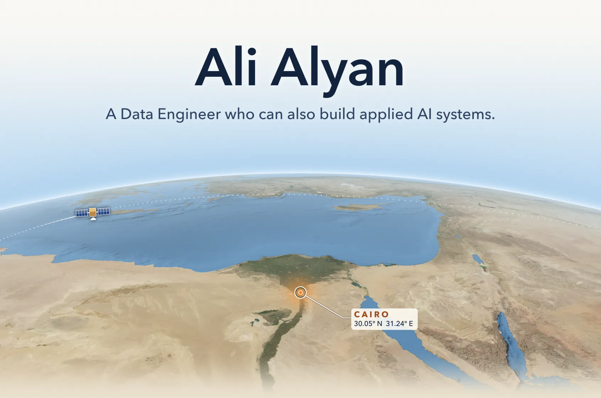
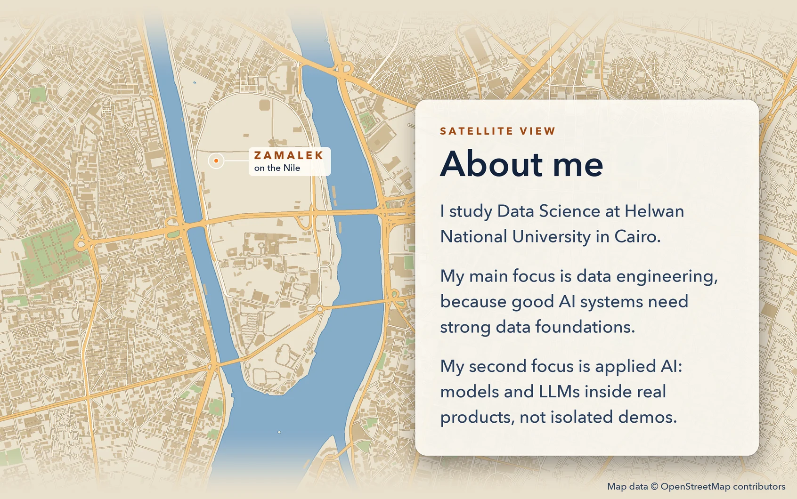
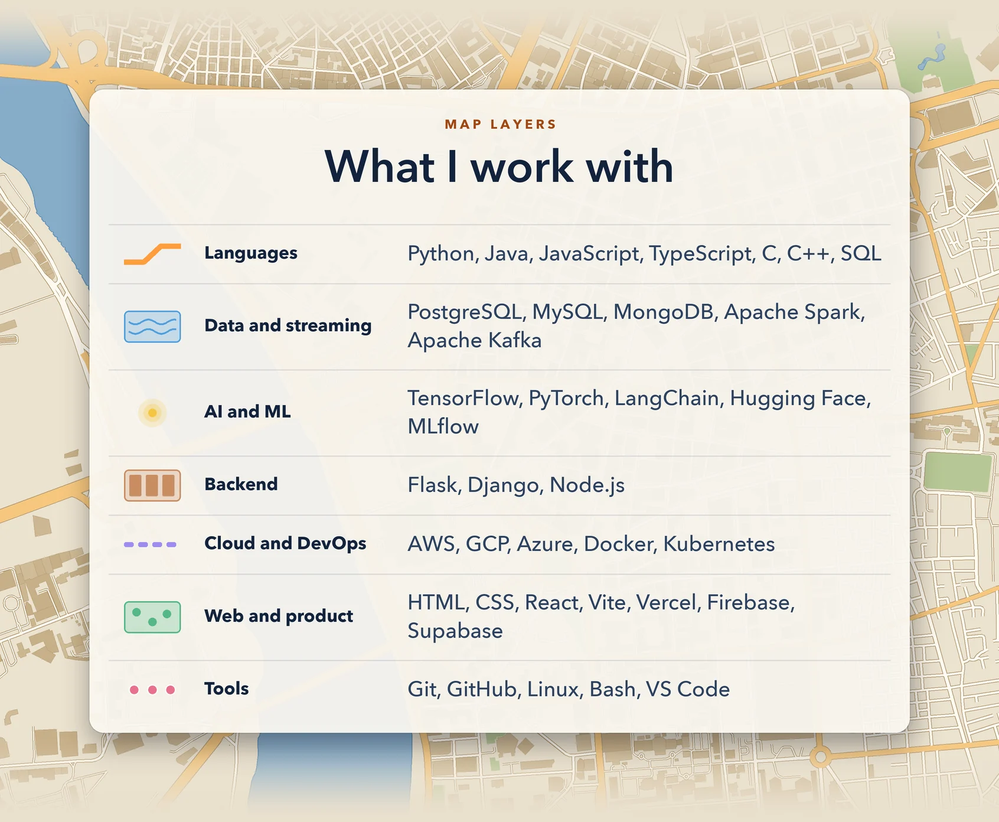
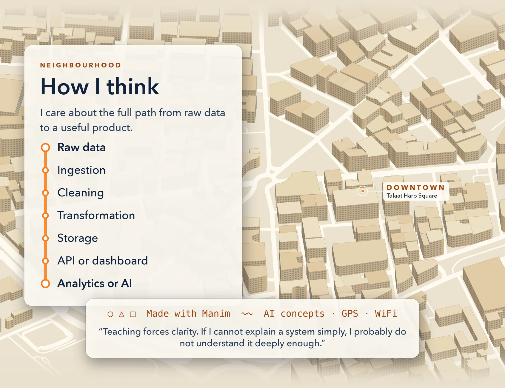
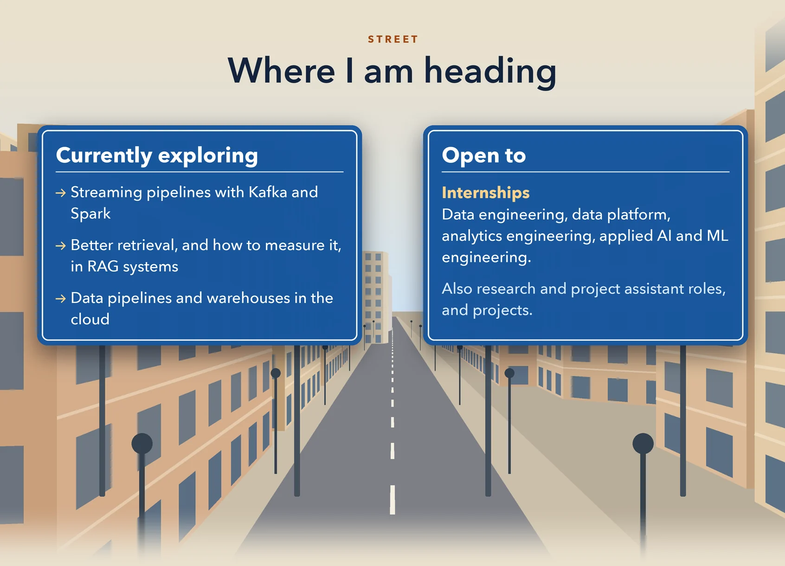
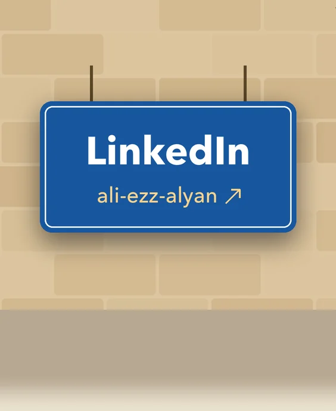
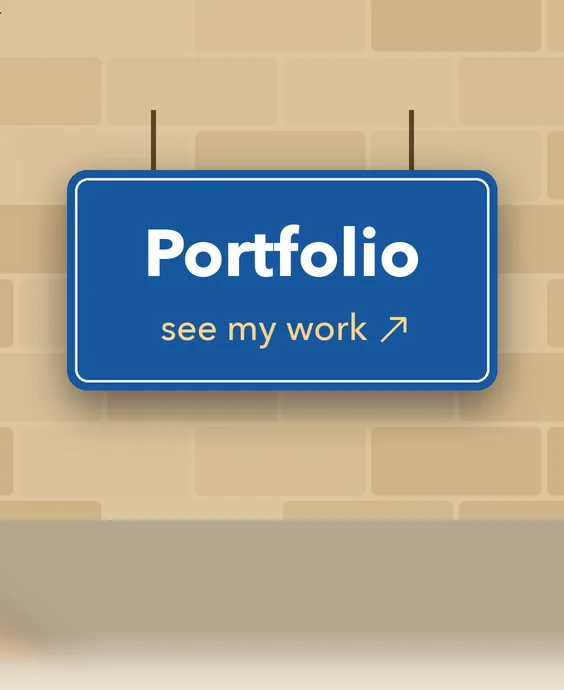

<picture><source media="(max-width: 600px) and (prefers-color-scheme: dark)" srcset="assets/orbit-phone-dark.webp"><source media="(max-width: 600px)" srcset="assets/orbit-phone-light.webp"><source media="(prefers-color-scheme: dark)" srcset="assets/orbit-dark.webp"></picture><picture><source media="(max-width: 600px) and (prefers-color-scheme: dark)" srcset="assets/satellite-phone-dark.webp"><source media="(max-width: 600px)" srcset="assets/satellite-phone-light.webp"><source media="(prefers-color-scheme: dark)" srcset="assets/satellite-dark.webp"></picture><picture><source media="(max-width: 600px) and (prefers-color-scheme: dark)" srcset="assets/layers-phone-dark.webp"><source media="(max-width: 600px)" srcset="assets/layers-phone-light.webp"><source media="(prefers-color-scheme: dark)" srcset="assets/layers-dark.webp"></picture><picture><source media="(max-width: 600px) and (prefers-color-scheme: dark)" srcset="assets/neighbourhood-phone-dark.webp"><source media="(max-width: 600px)" srcset="assets/neighbourhood-phone-light.webp"><source media="(prefers-color-scheme: dark)" srcset="assets/neighbourhood-dark.webp"></picture><picture><source media="(max-width: 600px) and (prefers-color-scheme: dark)" srcset="assets/street-phone-dark.webp"><source media="(max-width: 600px)" srcset="assets/street-phone-light.webp"><source media="(prefers-color-scheme: dark)" srcset="assets/street-dark.webp"></picture><picture><source media="(max-width: 600px) and (prefers-color-scheme: dark)" srcset="assets/door-top-phone-dark.webp"><source media="(max-width: 600px)" srcset="assets/door-top-phone-light.webp"><source media="(prefers-color-scheme: dark)" srcset="assets/door-top-dark.webp"></picture><a href="https://www.linkedin.com/in/ali-ezz-alyan/"><picture><source media="(max-width: 600px) and (prefers-color-scheme: dark)" srcset="assets/door-linkedin-phone-dark.webp"><source media="(max-width: 600px)" srcset="assets/door-linkedin-phone-light.webp"><source media="(prefers-color-scheme: dark)" srcset="assets/door-linkedin-dark.webp"></picture></a><picture><source media="(max-width: 600px) and (prefers-color-scheme: dark)" srcset="assets/door-door-phone-dark.webp"><source media="(max-width: 600px)" srcset="assets/door-door-phone-light.webp"><source media="(prefers-color-scheme: dark)" srcset="assets/door-door-dark.webp"></picture><a href="https://ali-ezz-portfolio.vercel.app"><picture><source media="(max-width: 600px) and (prefers-color-scheme: dark)" srcset="assets/door-portfolio-phone-dark.webp"><source media="(max-width: 600px)" srcset="assets/door-portfolio-phone-light.webp"><source media="(prefers-color-scheme: dark)" srcset="assets/door-portfolio-dark.webp"></picture></a>

