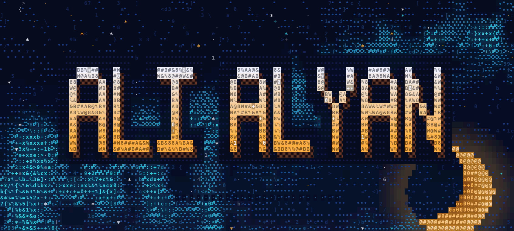
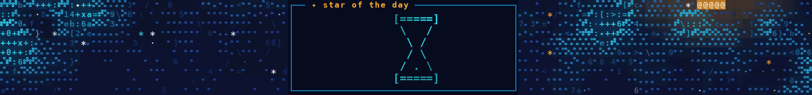
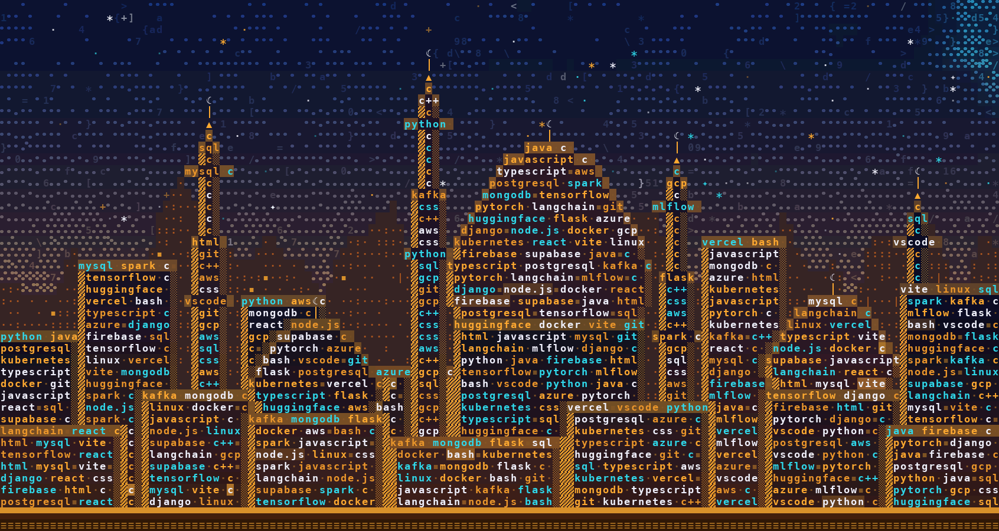
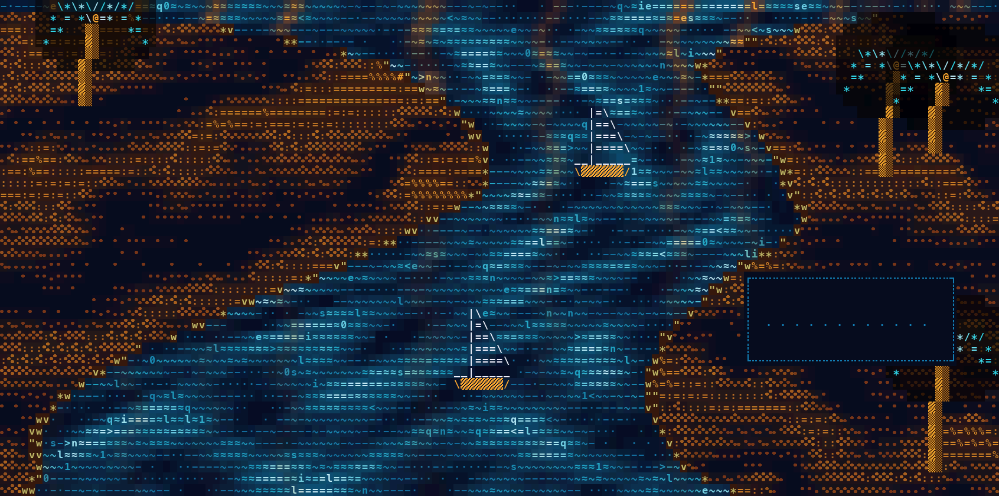

<picture><source media="(max-width: 600px)" srcset="assets/phone-sky.webp"></picture><picture><source media="(max-width: 600px)" srcset="assets/phone-star.webp"></picture><picture><source media="(max-width: 600px)" srcset="assets/phone-city.webp"></picture><picture><source media="(max-width: 600px)" srcset="assets/phone-river.webp"></picture>

